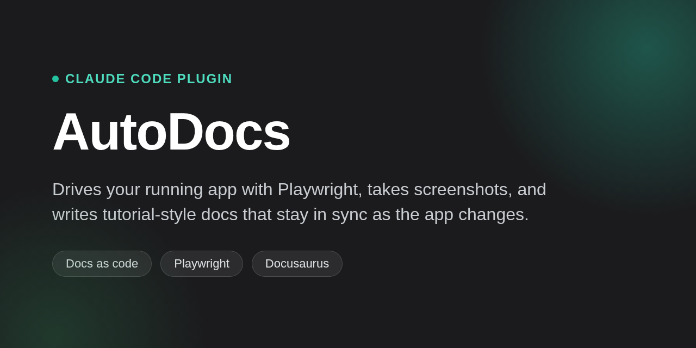

# DocSolace



Claude Code plugin that drives your running web app with Playwright, takes
screenshots, and writes tutorial-style Markdown docs that stay in sync as the
app changes — screenshot-driven, docs-as-code, built for solo developers.

[](./LICENSE)
[](#prerequisites)
[](./plugin/.claude-plugin/plugin.json)
[](https://github.com/esandeepchoudary/docsolace/actions/workflows/test.yml)
[](https://esandeepchoudary.github.io/docsolace/)

DocSolace is a Claude Code plugin for solo developers. It drives your
*running* web app in a headless browser, takes the screenshots itself, and
writes tutorial-style Markdown from what it actually saw. Docs stay in sync
because it only regenerates what changed.

## Quickstart

Inside Claude Code:

```
/plugin marketplace add esandeepchoudary/docsolace
/plugin install docsolace@docsolace-marketplace
```

Restart Claude Code (or run `/reload-plugins`), open your project, start your
app, and run:

```
/docsolace:document
```

The first run asks for your app's base URL and sets the project up. After
that, the same command does the right thing:

- **No arguments** — checks what you changed. If a tutorial covers it, that
  tutorial is re-captured and updated. If UI changed that no tutorial
  covers, it asks once for a short description and drafts one.
- **Plain words** — `/docsolace:document the new billing page` drafts a
  tutorial for that feature. No slug or mode needed.
- **A tour id** — `/docsolace:document login` updates just that tutorial.

Each run ends with an opened docs PR for you to review. It never merges.

## What it does

- **Drives your real app** — Playwright follows a YAML "tour" against the
  running app. No fixtures or mockups.
- **Grounds prose in what's on screen** — each screenshot is paired with an
  accessibility snapshot; nothing absent from it gets described.
- **Skips what hasn't changed** — a drift check compares screenshots and
  source `code_paths` against the last run.
- **Keeps your edits** — text inside `<!-- docsolace:keep -->` blocks
  survives every regeneration.
- **Publishes a docs site** — a bundled [Docusaurus](https://docusaurus.io/)
  scaffold serves `docs/`, with search.

## Prerequisites

- **Claude Code** ([install](https://docs.claude.com/en/docs/claude-code)).
  Prefer no Claude Code? The pipeline is plain Node scripts — see
  ["Running it without Claude Code"](./ADVANCED.md#running-it-without-claude-code).
- **Node.js 22+** and npm. The plugin installs its own dependencies
  (Playwright, js-yaml, etc.) into its own data directory on first use,
  never into your project.
- **git**, and the **GitHub CLI** (`gh`) for opening PRs.

## Install the plugin

This repo is also a Claude Code plugin marketplace with one plugin in it. You
don't need to clone it into your project.

```
/plugin marketplace add esandeepchoudary/docsolace
/plugin install docsolace@docsolace-marketplace
/reload-plugins
```

Working from a local clone? Use its path: `/plugin marketplace add /path/to/docsolace`.

The first session with the plugin active installs its dependencies and the
Playwright browser (a minute or so, once). Check it with `/plugin list`.
Updates arrive when the plugin's version changes: `/plugin update`, then
restart.

## Use it in your project

Run `/docsolace:document` in the project you want tutorials for. On the first
run it creates:

- `docsolace.config.yaml` — annotated, with every optional section as a
  commented example
- `tours/` — empty, with a short `README.md`
- `.env.example`, and `.gitignore` entries for `.docsolace/artifacts/` and
  `.env` so session cookies and credentials can't be committed

Day to day you only need these:

| Command | What it does |
|---|---|
| `/docsolace:document` | Work out what changed, resync covered tutorials, offer to draft one for uncovered UI, open a docs PR |
| `/docsolace:document <what you built>` | Draft and ship a tutorial for that feature |
| `/docsolace:document <tour-id>` | Re-capture and update one tutorial |

`validate` and `prune` run automatically at the start of each normal run.
The maintenance modes (`map`, `prune`, `product`, `validate`, `status`,
`init-site`, and explicit `propose <slug> "<description>"`) are in
["All commands"](./ADVANCED.md#all-document-commands). Add `--review` to any
mode to stop and ask at each step instead of running autonomously, or
`--no-style` to skip design-skill detection.

A run stops and asks only at a few hard stops: the feature couldn't be
grounded in the app, a voice flow (always reported unverified), a `validate`
error, an auth session that needs a human at a headed browser, or a
hand-edited docs page outside its keep-region. See `tours/dashboard-export.yaml`
in this repo for a worked example.

### It ships a docs PR for you

Once a run has something to commit, it:

1. runs `verify-docs` — every image reference and internal link under all of
   `docs/` must resolve, or it stops;
2. runs `review-diffs` and puts that report in the PR body (the only place a
   screenshot change is visible before push);
3. stages only `docs/` and `tours/*.yaml`;
4. commits onto your current branch if it's `feat/*` or `fix/*`, otherwise
   onto a new `docs/<slug>` branch — never straight to `main`;
5. pushes and opens (or updates) the PR. It never merges.

A second `SessionStart` hook has Claude end a reply with one line, "run
`/docsolace:document`", only when it changed UI files that session. Nothing
for backend, test, or config changes. Wording is in
`plugin/scripts/lib/session-guidance.mjs`.

### It also documents the product itself

Alongside tour pages, `/docsolace:document product` (and the normal
no-argument run) writes up to seven product-level pages: `overview`,
`getting-started`, `concepts`, `configuration`, `troubleshooting`,
`changelog`, `decisions`. They're grounded only in repo files — `README.md`,
`package.json`, `.env.example`, `docsolace.config.yaml`, `CHANGELOG.md`, any
`docs/adr/*.md`, extra `product.sources` globs, and the tour inventory —
never the running app, and never `.env`, key files, or `.auth/`. A page with
nothing to ground it is skipped and reported, not padded. `decisions` only
surfaces reasoning a human wrote in an ADR. Details: [CONFIGURATION.md](./CONFIGURATION.md).

## How it works

1. **Capture** — a **tour** is a YAML file: pages to visit, what to click,
   where to screenshot. DocSolace drives a headless browser through it at
   every configured viewport (desktop and mobile by default), saving an
   accessibility snapshot with each screenshot.
2. **Drift check** — if a tour's screenshots and source code are unchanged,
   skip it. This keeps the expensive step cheap.
3. **Generate** — for changed tours, a subagent writes prose from the
   accessibility snapshot only. Your `<!-- docsolace:keep -->` regions are
   preserved.
4. **Publish** — Markdown lands in `docs/`, viewable as-is or through the
   Docusaurus site ([PUBLISHING.md](./PUBLISHING.md)).

Product pages follow the same shape without step 1: their ground truth is
the repo, not a browser.

## More

- **[CONFIGURATION.md](./CONFIGURATION.md)** — config, tours, styling, product pages, sidebar sections
- **[PUBLISHING.md](./PUBLISHING.md)** — building and deploying the docs site
- **[TROUBLESHOOTING.md](./TROUBLESHOOTING.md)** — common issues, updating the plugin
- **[ADVANCED.md](./ADVANCED.md)** — all commands, uploads, forms, async waits, CAPTCHA, non-password logins, integrations, seeds, voice, mapping a whole app, CI
- **[CONTRIBUTING.md](./CONTRIBUTING.md)** — project layout and developing on the plugin

## License

[ISC](LICENSE)
